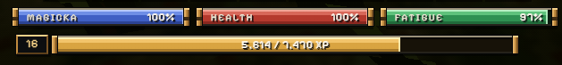

> [!NOTE]
> **Applies to:** Online play. Verified against the source code for Update **0.0.468** (2026-10-28; `app-v0.1.12955`).
>
> The initial commit of this page was prepared with the assistance of AI tools. Readers are encouraged to verify the information against the game and official sources, and to contribute corrections and improvements.

{right 420}

Renown is a separate progression level earned through online activities. It exists alongside the character's normal Daggerfall level and provides additional maximum health and Magicka during online play.

Renown is tracked separately for each character and stored on the game's servers rather than in the Daggerfall save file. Playing offline does not earn Renown XP, and the additional attributes granted by Renown are not applied offline.

## Earning Renown

Renown XP comes from combat, quests, Arena victories, world events and completed writs. Rewards are credited to the character that earned or claimed them. Most sources use the same account-wide limit of **15,000 XP per clock hour**; gathering and crafting writ rewards are credited separately and do not use that hourly allowance. No source can raise a character above Renown 50.

### Defeating enemies

A kill can award XP when the enemy dies within **30 seconds** of a hit you landed. Every eligible player receives the full kill award, even if another player deals the final blow. For party members in the same room, each additional member adds **10 percentage points of the base kill award**, up to eight members total. A full party can receive **170% of the base kill award per eligible player**.

The kill's effective enemy level is the lowest of the enemy's level, **Renown + 3**, and **30**. XP is `floor(0.75 × 10 × effective enemy level)`, before the party bonus. For example, a level-30 enemy at Renown 1 is counted as level 4 and awards **30 XP** before any party bonus.

City watch, townspeople, your own allies and kills treated as murder do not award Renown. A scripted kill without a qualifying hit, or an enemy that dies to poison more than 30 seconds after your last hit, also gives no XP.

### Completing quests

Ordinary quest XP is based on your Daggerfall character level, limited to **Renown + 3** and level **30**. The reward is `floor(0.75 × (100 + 40 × effective character level))`. This limit prevents a high-level character from earning Renown as if every quest were scaled to level 30 from the start.

### Winning Arena bouts

A victory in the PvE Arena ladder or a rated player-versus-player bout awards Renown to the character named for the claim. A loss, draw, unrated match, or replay of a ladder step already won gives no Renown.

A regular ladder win pays the equivalent of one quest at its tier's reference level; higher tiers use higher reference levels. A tier champion bout pays twice that amount, and the Grand Champion bout pays three times the top-tier amount. A rated PvP win pays one quest reward at level 30, subject to the same Renown-level scaling limit as other quest-based rewards. The account's hourly XP limit applies.

### Participating in world events

- **Raiding parties:** A successful claim for a defended town pays the equivalent of **three level-30 quest rewards**, scaled to the character's Renown. An account can claim up to six raids per game day. The account-wide hourly XP limit applies.
- **Fallen stars:** Claiming a fallen star after eligible participation pays the same Renown as defending a town from a raid. Each star pays an account once, and the hourly limit applies.
- **Sea serpent:** A successful claim for a serpent slain pays **six level-30 quest rewards**, scaled to Renown. If the character's participation is recorded as staying through the fight rather than dealing damage, the reward is halved. The hourly limit applies.

Event rewards are paid to the character that fought the event. A signed event claim can credit only the amount remaining under the account's hourly allowance and the character's Renown cap.

### Completing writs

**Gathering writs** include daily Court writs and writs posted by guild chapters. Completing a writ awards `floor(0.75 × 25 × tier × units ÷ 10)` Renown XP, where *tier* and *units* are the writ's tier and requested quantity. The reward is credited separately from the hourly XP allowance.

**Crafting writs** are offered on the daily Work board, up to three per account each UTC day. Completing a writ awards `floor(0.75 × 2 × silver pay)` Renown XP. The reward is credited separately from the hourly allowance. The writ must be completed with the required goods or crafted items before it expires.

## Levels and attribute bonuses

Every character begins at Renown 1. The maximum is **Renown 50**, requiring **2,318,660 total XP**. Each level above 1 adds **3 maximum health** and **2 maximum Magicka** during online play.

For a Renown level *L* from 1 to 50, let *n = L − 1*. The total XP required to reach that level is *10 × floor((n³ × (n + 10) + 300 × n) ÷ 30)*. The table shows selected levels.

| Renown | Total XP required | Bonus health | Bonus Magicka |
| ---: | ---: | ---: | ---: |
| 1 | 0 | 0 | 0 |
| 5 | 690 | +12 | +8 |
| 10 | 5,510 | +27 | +18 |
| 20 | 68,200 | +57 | +38 |
| 30 | 319,950 | +87 | +58 |
| 40 | 972,770 | +117 | +78 |
| 50 | 2,318,660 | +147 | +98 |

The values are additional to the character's ordinary maximum health and Magicka. Renown does not replace normal character levels, skills or other progression systems.

## Effects on other mechanics

### Firmament

Each Renown level after level 1 grants **2 Stars** to spend in [[Firmament]], for a maximum of **98 Stars at Renown 50**. See the Firmament guide for allocation rules, bonuses and restrictions.

### Sigils and loot

Renown determines the highest stage of a weapon's sigil power that its wielder can use online. The active stage is limited by both the character's Renown and the sigil's own XP progression.

| Renown | Stage |
| --- | --- |
| 1–9 | Faint |
| 10–19 | Kindled |
| 20–29 | Bright |
| 30–39 | Radiant |
| 40–50 | Ascendant |

Sigil damage bonuses are inactive offline. Higher Renown also improves the online loot bonuses associated with these same five stages. Offline loot does not scale with Renown.

### Enemy encounters

In online play, **Renown 5** is required for elite enemies generated by the player's own open-world encounters and searches. This restriction does not apply to elite selections in shared dungeons.

**Renown 10** is required for the character's revenants to become active online. Revenants also require the Loot rarity setting to be enabled. These Renown requirements do not restrict the corresponding offline encounters.

## Progress and limits

The in-game HUD displays the current Renown level and an XP progress bar. XP earned but not yet confirmed by the servers can appear as a provisional portion of the bar. Renown is also displayed beside player names and in profiles; the account view includes character progress.

The game's servers enforce the following limits:

- **15,000 XP per clock hour per account** for standard reported XP and eligible combat or event claims, shared across all characters on the account. XP beyond the available allowance is not credited.
- **Renown 50** is the level cap. Once the character has reached the required total, further XP is not stored.
- An account can hold Renown tracks for up to **60 living characters**. Records of deceased or retired characters do not occupy this allowance.

Writ rewards are an exception to the hourly XP allowance: their Renown is awarded separately from the standard hourly report system.

## Sources

Source code for Update **0.0.468** (`app-v0.1.12955`):

- [Renown implementation](https://github.com/Lattymoy/daggerfall-js-source/blob/app-v0.1.12955/src/net/renown.js)
- [Combat tracking](https://github.com/Lattymoy/daggerfall-js-source/blob/app-v0.1.12955/src/net/renownTracker.js)
- [Arena rewards](https://github.com/Lattymoy/daggerfall-js-source/blob/app-v0.1.12955/server-account/src/arena.js)
- [Raid rewards](https://github.com/Lattymoy/daggerfall-js-source/blob/app-v0.1.12955/server-account/src/raids.js)
- [Star rewards](https://github.com/Lattymoy/daggerfall-js-source/blob/app-v0.1.12955/server-account/src/stars.js)
- [Serpent rewards](https://github.com/Lattymoy/daggerfall-js-source/blob/app-v0.1.12955/server-account/src/serpents.js)
- [Writ rewards](https://github.com/Lattymoy/daggerfall-js-source/blob/app-v0.1.12955/server-account/src/professions.js)
- [Renown bonuses](https://github.com/Lattymoy/daggerfall-js-source/blob/app-v0.1.12955/src/systems/renownLayer.js)
- [Sigil stages](https://github.com/Lattymoy/daggerfall-js-source/blob/app-v0.1.12955/src/systems/sigil/sigil.js)
- [Renown-based loot](https://github.com/Lattymoy/daggerfall-js-source/blob/app-v0.1.12955/src/systems/renownLoot.js)
- [Elite enemies](https://github.com/Lattymoy/daggerfall-js-source/blob/app-v0.1.12955/src/systems/eliteFoes.js)
- [Revenants](https://github.com/Lattymoy/daggerfall-js-source/blob/app-v0.1.12955/src/systems/revenant/revenant.js)
- [HUD implementation](https://github.com/Lattymoy/daggerfall-js-source/blob/app-v0.1.12955/src/ui/hud/hudRenown.js)
- [Account-side Renown tracking](https://github.com/Lattymoy/daggerfall-js-source/blob/app-v0.1.12955/server-account/src/renownTracks.js)
- [Crafting writ delivery](https://github.com/Lattymoy/daggerfall-js-source/blob/app-v0.1.12955/server-account/src/craftWrits.js)
